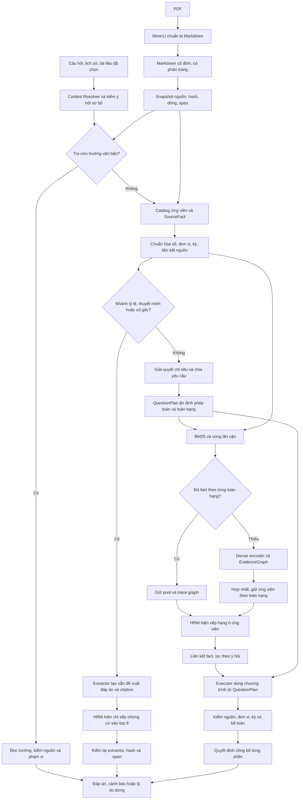
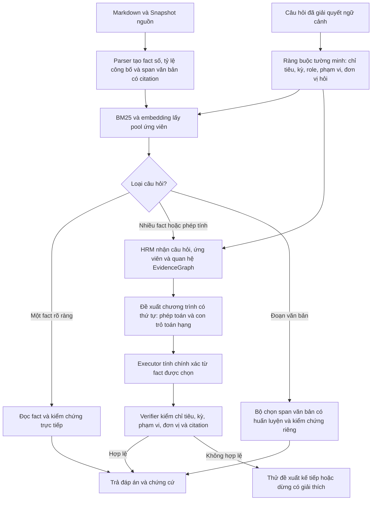

> **Audit source_period_v1 phát hiện lỗi cần xử lý:** ba ca CCM/DPC vẫn đúng, nhưng phản ví dụ mới cho thấy bỏ lọt mâu thuẫn cùng ngày, gán sai năm hồ sơ và chọn sai thời điểm trong năm. Grader cũ có thể PASS dữ liệu thiếu ca/sai đơn vị/ERROR. Runtime và gold chưa sửa. [Báo cáo audit](data/test/suites/source_period_review_v1/analysis.md).

> **Đã bàn giao source_period_v1:** binding kỳ nguồn và endpoint đã phục hồi 3 ca CCM/DPC; bộ development/replay đạt 4/4 câu có đáp án. 142 kiểm thử đạt, 230 chữ ký hồi quy giữ nguyên; 17 ca HTTP đạt tiêu chí riêng, gồm đáp án và guard. Không đổi transfer lần đầu, HRM/graph/encoder/checkpoint hoặc tolerance. [Báo cáo và giới hạn](data/test/suites/source_period_v1/analysis.md).

> **Bàn giao lookup_context_v1:** đã sửa tra cứu không nêu năm/nhãn–giá trị và kiểm backend bản cuối. 129 kiểm thử đạt; 230 chữ ký hồi quy giữ nguyên; câu vốn TIE và bốn phản ví dụ KH/TH đạt. **CCM/DPC mới chỉ 1/4 câu có đáp án trả đúng**, còn lỗi kỳ nguồn/đầu–cuối kỳ. [Báo cáo và hướng tiếp](data/test/suites/lookup_context_v1/analysis.md).

> **Đã kiểm lại bằng 33 câu HTTP thực tiễn:** 21/21 replay khớp hành vi cũ; 4/8 biến thể trả đúng số theo chính sách hiện hành; 3 ca MGG/ACG vẫn trả đúng, VIE chưa phục hồi. Đã xác định lỗi bảng nhãn–giá trị, role SELECT không nêu năm và mất ngữ cảnh bảng nối trang. Bản sửa đơn vị 9/9 kiểm thử chạy lại đạt; chưa sửa runtime trong lượt audit. [Báo cáo đúng/sai và giới hạn](data/test/suites/practical_review_v1/analysis.md).

> **Đã hoàn tất đánh giá độc lập 21 câu TIE/VEC/TAB: chưa đạt.** 3/10 câu có đáp án theo gold khóa trước chạy trả đúng đầy đủ; 1 sai KH/TH, 6 chưa trả đủ. Tách riêng 8 ca thiếu, 2 ca phạm vi/công bố và 1 ca dữ liệu một phần. Gold TAB ưu tiên số chi tiết có giới hạn cần đọc trong báo cáo; không đổi điểm/gold sau chạy. Runtime giữ nguyên. [Phân tích](data/test/suites/independent_reports_v2/analysis.md).

> **Bản sửa đơn vị đã kiểm chứng:** 121 kiểm thử + 3 gateway fixture đạt; 230/230 chữ ký giữ nguyên so với fact_plan_recovery_v1; backend 18/18 khớp và 3/3 ca cơ chế đơn vị đạt. VIE chưa phục hồi; UI thật chưa kiểm được. Bộ TIE/VEC/TAB 21 câu đang chuẩn bị nguồn dưới mã đã khóa, chưa có kết quả độc lập. [Bàn giao](data/test/suites/unit_evidence_v1/delivery.md).

# Tổng quan FinHRM: quá trình sửa đổi, kiến trúc hiện tại và hướng xử lý tiếp

> **Holdout nguồn mới — 25/09/2026:** 40 câu trên 5 PDF được khóa nguồn, gold, runtime và checkpoint trước dự đoán; gold do một người kiểm bằng MinerU và PDF, chưa có người thứ hai duyệt. Cả `off`, baseline không HRM và V14.1 HRM đúng 1/40, công bố sai 0/40 ca dương tính, dừng 39/40; chỉ 5 câu vào fact pool nên chưa đánh giá được khả năng chọn chương trình cạnh tranh của HRM. 5/5 pool cùng hash, 9/9 đề xuất chung cùng lý do verifier. Scorer gốc gán nhầm recall=false cho 35 ca chưa có pool và bỏ sót một dòng doanh thu tương đương trong gold; giữ nguyên kết quả khóa, ghi audit hậu nghiệm riêng. [Báo cáo](data/test/suites/hrm_value_eval_20260925/holdout_first_run_report.md).

> **Phục hồi tỷ lệ dính ô và chung thang đo — 24/09/2026:** parser gắn span tỷ lệ `17,97%` với đúng hàng chỉ tiêu sau khi kiểm một-một nhãn/token từng cột; verifier chỉ tính phần trăm từ hai số thiếu đơn vị tuyệt đối khi có chứng cứ cùng bảng/cột/kỳ/phạm vi và không có ghi đè đơn vị. Tỷ lệ in còn phải khớp cặp toán hạng độc lập; không chuyển đơn vị sang VND. Ảnh PDF gốc xác nhận vị trí ca AAS, citation hash/span hợp lệ. Trên 18 câu số đã khóa, đường mặc định nay **17 đúng/1 dừng**; baseline và HRM V14.1 tăng từ 16 lên **17 đúng/1 dừng**; chỉ câu biên ròng đổi, không thấy công bố sai trong 17 đáp án theo gold. TAB 19/1/12 và SGD giữ nguyên; **301 test post-HRM qua**. HRM không vượt baseline, vẫn tắt mặc định. [Báo cáo và nguồn](data/test/suites/financial_breadth_tab_transfer_20260924/compound_ratio_stage4.md).

> **Cập nhật đường biên lợi nhuận — 24/09/2026:** checkpoint đo là **V14.1** (`document_hrm_V14_1_bkai_scratch_seed31_v1.pt`, SHA-256 `e6641d13f169dc674728c32aafb508946495027985ce1fde6e2b1095a8d55413`). Đường số thử nghiệm nay tạo cặp fact lợi nhuận/doanh thu thuần cho câu hỏi biên % không cần chữ “tính”; HRM đề xuất phép toán và con trỏ, cùng baseline đi qua executor/verifier. Trên nguồn tổng hợp đủ chứng cứ, V14.1 chọn đúng `RATIO_PERCENT` và cặp fact; phản ví dụ thiếu đơn vị, phạm vi, mẫu số hoặc tỷ lệ in mâu thuẫn đều dừng. Trên TAB và 18 câu nhiều báo cáo, trạng thái/giá trị giữ nguyên (19/1/12 và 16 đúng/2 dừng); ca biên ròng thật vẫn thiếu mẫu số có đơn vị được chứng minh. SGD giữ nguyên; 293 test post-HRM qua. Chưa có bằng chứng tăng coverage hoặc hơn baseline trên ca nhiều lựa chọn, nên HRM số vẫn mặc định tắt. [Báo cáo](data/test/suites/financial_breadth_tab_transfer_20260924/numeric_program_margin_stage3.md).

> **Cập nhật chính sách đơn vị/liên kết chỉ tiêu — 24/09/2026:** giữ `unit_state` (đơn vị trực tiếp, kế thừa có chứng cứ, số gốc chưa rõ đơn vị) tách khỏi `metric_link_state` (tên chỉ tiêu liên quan nhưng chưa đồng nhất). Dò công bố khác tên nay dùng quan hệ metric có giới hạn, cùng nguồn/kỳ/role/phạm vi và peer có chứng cứ đơn vị, không dựa riêng vào từ khóa doanh thu hoặc số trùng. Tra cứu danh nghĩa chỉ công bố chuỗi gốc; câu ép đồng dừng có giải thích; không chuyển đơn vị giữa hai metric. HKT 4/4 trước/sau giữ đúng; TAB 19/1/12 và bộ 18 câu số 16 đúng/2 dừng giữ nguyên, 0 đáp án sai được công bố trong 16 câu được trả; 286 test post-HRM qua. Đây là cải thiện minh bạch/chính sách nguồn, chưa tăng tỷ lệ trả lời hay chứng minh HRM tốt hơn. [Báo cáo](data/test/suites/unit_policy_general_20260924/report.md).

> **Cập nhật giai đoạn 2 — kiểm tra giá trị HRM:** pool giữ từng diễn giải fact; baseline không dùng HRM nay ưu tiên đơn vị có chứng cứ và độ chính xác nguồn; đường thử được kiểm thêm về ngày chốt, mâu thuẫn, phạm vi, đơn vị và thang hiển thị. Trên 32 câu TAB, cả hai selector vẫn 19 ACCEPTED, 1 RAW_DISCLOSURE, 12 ABSTAIN. Ưu thế P01 của HRM ở baseline thứ tự nguồn biến mất: cả hai chọn số chi tiết. Bộ 18 câu số thuộc năm báo cáo đã khóa cho 16 đáp án đúng, 2 dừng và 0 đáp án sai được công bố ở cả hai selector; 14 câu qua chương trình chỉ có một chương trình được verifier thử nghiệm chấp nhận. 282 test post-HRM qua. Chưa có bằng chứng bật HRM mặc định hoặc huấn luyện lại; [kết quả và giới hạn](data/test/suites/financial_breadth_tab_transfer_20260924/numeric_program_stage2.md).

> **Mốc giai đoạn 1 (24/09/2026):** cổng top 8 nay chỉ ghi trace; văn bản và số gốc chưa rõ đơn vị đi qua hợp đồng nguồn, không vào checkpoint số bằng giá trị giả `0`. Chế độ thử `numeric_program_mode=hrm` cho head operation/pointer/pair đề xuất chương trình từ fact có nguồn, rồi executor và verifier kiểm trước khi trả lời; chế độ `baseline` dùng cùng pool/verifier. Mặc định vẫn là đường cũ vì trên 32 câu TAB chỉ 2 câu có hơn một chương trình hợp lệ, chưa đủ bằng chứng bật HRM mặc định. Cả hai chế độ cho 19 ACCEPTED, 1 RAW_DISCLOSURE, 12 ABSTAIN; 274 test post-HRM qua. [Kết quả đo](data/test/suites/financial_breadth_tab_transfer_20260924/numeric_program_stage1.md). Các số liệu cũ bên dưới là mốc lịch sử.

> **Cập nhật triển khai: fact_plan_recovery_v1.** Đã phục hồi hai câu MGG và một câu ACG, nạp và kiểm tra backend demo. Nhóm phục hồi 9/9 đúng; tính cả VIE có số tham chiếu là **9/10**, VIE vẫn chưa phục hồi. Chuyển PSD/NBW 4/4 số đúng + 2 ca thiếu năm giữ chặn. 112 kiểm thử post-HRM + 3 gateway thử riêng đạt; 228/230 chữ ký hồi quy giữ nguyên, hai MGG đổi sang số chi tiết đã đối chiếu. [Bàn giao mới](data/test/suites/fact_plan_recovery_v1/delivery.md). Các số liệu architecture_integration_v1 bên dưới là mốc lịch sử.

**Các mốc lịch sử của bản tổng quan trước 24/09/2026:** bản `architecture_integration_v1`, các phân tích tham khảo và bản sửa đã nghiệm thu `fact_plan_recovery_v1`. Tài liệu này tổng hợp kết quả đã lưu; việc viết tài liệu không phải một lượt sửa mã, chạy benchmark hay kiểm tra lại trạng thái dịch vụ.

**Trạng thái:** đã thay đường symbolic cũ trong luồng trả lời bằng Post-HRM Contract Engine, bổ sung xử lý ngữ cảnh, guard số và truy hồi thích ứng dùng graph hiện có. Bản bàn giao đã được nạp và kiểm tra trên backend demo. Hệ thống có tiến bộ ở các cơ chế đã kiểm thử, nhưng **chưa đạt yêu cầu trả lời ổn định mọi thông tin trên mọi báo cáo**.

## 1. Mục tiêu và vấn đề xuất phát

Mục tiêu là người dùng chọn báo cáo rồi hỏi tự nhiên; hệ thống đọc đúng thông tin, tính đúng khi cần và dẫn được bằng chứng. Một tài liệu đã chọn thường đủ xác định công ty báo cáo, nên không bắt người dùng nhập lại tên công ty nếu ngữ cảnh đã rõ. Tuy nhiên, thông tin công ty mẹ, hợp nhất, công ty con và chi nhánh trong cùng tài liệu vẫn phải phân biệt.

Các lỗi thực tế đã dẫn tới quá trình sửa đổi:

- Câu đơn giản như vốn điều lệ có trong báo cáo nhưng hệ thống không trả được.

- Cùng cách hỏi doanh thu/lợi nhuận, báo cáo này trả được nhưng báo cáo khác thất bại.

- Câu hỏi tiếp làm mất chỉ tiêu, năm hoặc phép tính của câu trước.

- Bảng nối trang, nhãn rút gọn, hàng “khác”, câu văn và đơn vị không tới được bằng chứng cuối.

- Số đúng bị chặn, hoặc số đã đọc sai vẫn có thể vượt kiểm tra kiểu dữ liệu.

- Phản hồi lặp, khó hiểu hoặc nêu sai nguyên nhân không trả lời.

Không phải mọi lỗi này đều do symbolic quá chặt hoặc HRM chọn sai. Nếu mất ý hỏi, mất ô nguồn hoặc chuẩn hóa sai trước đó thì thay verifier không tự phục hồi được thông tin.

**OCR thành Markdown không làm mọi báo cáo có cùng cấu trúc.** Định dạng tệp giống nhau nhưng header, bảng nối trang, nhãn–giá trị, đơn vị, ngày/kỳ và đoạn văn vẫn khác. Cần xử lý những quan hệ này trên bằng chứng nguồn.

## 2. Các giai đoạn thay đổi chính

| Giai đoạn | Nội dung và ý nghĩa |

|---|---|

| Sửa các lỗi câu hỏi thực tế | Xử lý đơn vị/kỳ, chỉ tiêu doanh thu, hội thoại làm rõ, lựa chọn KH/TH và cách trình bày. Các lần chuyển sang báo cáo khác tiếp tục bộc lộ lỗi; kết quả trên báo cáo dùng sửa chưa đủ chứng minh tổng quát hóa. |

| Thay tầng sau HRM | Chuyển sang hợp đồng dữ liệu, liên kết nguồn, tính toán xác định và đối chiếu kế toán/liên kỳ có điều kiện. Không còn fallback symbolic cũ trong luồng demo đã bàn giao. |

| Mở rộng thông tin báo cáo | Bổ sung trường văn bản, câu nhiều trường, nhân sự theo kỳ, giải thích công bố mâu thuẫn và đối chiếu độ làm tròn. |

| Kiểm tra chuyển công ty | MST/PSD/HMR dùng chẩn đoán; VIE/NBW/UDC được đánh giá sau khi khóa mã ở lượt đó. Kết quả mới bộc lộ sai cách đọc số, mất fact câu văn và thiếu cấu trúc trường. |

| Bổ sung kiến trúc hiện tại | Resolver trước planner; truy hồi thích ứng BM25/dense/graph; giữ ứng viên theo toán hạng; guard số mơ hồ; tách thiếu bằng chứng khỏi không áp dụng. |

| Đọc phân tích tham khảo | Tiếp nhận hướng đo từng chặng, chỉnh cách mô tả vai trò HRM/graph và ưu tiên sửa lỗi có bằng chứng. Đây mới là bổ sung tài liệu, chưa phải các sửa runtime tiếp theo đã hoàn thành. |

Mã symbolic cũ có thể còn trong kho phục vụ lịch sử/offline. “Thay symbolic cũ” nói về đường quyết định trả lời đang dùng, không có nghĩa loại bỏ kiểm chứng bằng chứng hoặc phép tính xác định.

Nguồn lịch sử: [bàn giao tầng sau HRM](data/test/suites/post_hrm_contract_v1/delivery.md), [mở rộng thông tin](data/test/suites/report_information_v1/delivery.md), [chuyển công ty](data/test/suites/company_holdout_v1/analysis.md).

## 3. Kiến trúc đang chạy và kiến trúc mục tiêu

Hai sơ đồ trong mục này tách rõ mã đang chạy khỏi hướng muốn triển khai. Một số bước dùng chung hàm hoặc cache; không phải mọi ô đều là một dịch vụ riêng.

**Luồng đang chạy — HRM chủ yếu xếp hạng chứng cứ:**



PDF được chuẩn bị thành Markdown trước khi hỏi; runtime không nhận PDF trực tiếp. Planner sơ bộ cũng có thể yêu cầu làm rõ trước khi đọc nguồn. Ba nhánh đề xuất có thể kết thúc trước luồng `QuestionPlan` chính; một đề xuất dừng không có citation được trả trực tiếp, còn đề xuất có citation đi qua bước xếp hạng và kiểm lại nguồn.

Ngoài các nhánh trên, luồng số giữ cơ chế recovery có giới hạn: nếu pool thiếu nhưng catalog đã có fact phù hợp, lấy lại ứng viên đó và chạy xếp hạng HRM lại. Vì vậy, so sánh truy hồi phải tính cả recovery, không giả định baseline chỉ có BM25 thuần.

**Luồng mục tiêu cho câu cần suy luận — mới triển khai một phần ở chế độ thử:**



Trong sơ đồ mục tiêu, tỷ lệ in sẵn là fact để HRM có thể đề xuất `SELECT`; hai ô doanh thu là toán hạng để đề xuất `PERCENT_CHANGE`. HRM phải tạo **phép toán và con trỏ** từ pool, thay vì chỉ xét một đáp án extractor đã viết. Verifier vẫn quyết định có được công bố; nhánh văn bản không dùng ứng viên số giả `0`. Cổng top 8 đã chuyển sang chỉ ghi trace; đường thử HRM số và so sánh baseline được nêu ở mục 10.1. Đường thử hiện giữ đủ fact đã xác minh nếu pool vừa ngân sách checkpoint; khi quá ngân sách mới dùng BM25/embedding và EvidenceGraph để chọn ô vật lý. Quan hệ graph chưa được đưa trực tiếp như đầu vào có huấn luyện cho checkpoint. Bộ nguồn phát triển hiện chưa có ca số nào vượt ngân sách, nên hiệu quả truy hồi ở tình huống này chưa được chứng minh trên báo cáo thật.

**Sơ đồ trên là một luồng sản phẩm mục tiêu, không phải hai nhánh triển khai.** `numeric_program_mode=hrm` là đường thử cho bước HRM đề xuất chương trình; `baseline` chỉ là bộ chọn quy tắc làm đối chứng ở bước 3 mục 10.1, dùng cùng fact pool và verifier để đo phần giá trị do HRM mang lại. `off` là đường trả lời hiện hành trước khi quyết định bật luồng mục tiêu; demo gateway 50 câu ngày 25/09 chạy ở chế độ này. Các guard nguồn/đơn vị/thang đo áp dụng chung, không thuộc riêng baseline.

### 3.1. Nguồn tài liệu và bằng chứng

PDF đi qua MinerU rồi lưu Markdown. Snapshot giữ hash tài liệu; bằng chứng liên kết tới trang, dòng, đoạn ký tự hoặc ô bảng. Catalog số được xây từ nguồn, không lấy năm trong câu hỏi làm năm của ô số.

Một `SourceFact` cần giữ được những thuộc tính liên quan: chỉ tiêu, giá trị, đơn vị/thang đo, kỳ, KH/TH, doanh nghiệp/phạm vi và vị trí nguồn. Số giống nhau nhưng khác một trong các chiều này không tự trở thành cùng một fact.

**Trạng thái đơn vị hiện hành:** fact tiền tệ phân biệt `EXPLICIT_BOUND`, `INHERITED_PROVEN` và `UNIT_UNRESOLVED_RAW`; mơ hồ trùng số nhưng lệch tên chỉ tiêu được ghi riêng bằng `NAME_COLLISION_AMBIGUOUS` ở liên kết chỉ tiêu. Số gốc chưa rõ đơn vị không có giá trị tiền chuẩn hóa để tính hoặc trả lời câu hỏi ép đơn vị “đồng”. Câu chỉ hỏi số ghi trong bảng có thể nhận `RAW_DISCLOSURE` kèm cảnh báo và citation. Không dùng mặc định VND/thang 1 để biến số thiếu chứng cứ thành số tiền đã xác nhận.

### 3.2. Context Resolver trước planner

Ví dụ:

```text

Lượt 1: Doanh thu thuần năm 2025 tăng bao nhiêu phần trăm so với 2024?

Lượt 2: Còn lợi nhuận sau thuế?

Ý hỏi cần giữ ở lượt 2:

Lợi nhuận sau thuế năm 2025 tăng bao nhiêu phần trăm so với 2024?

```

Resolver mới xử lý dạng hỏi tiếp đổi chỉ tiêu có dấu hiệu rõ, giữ năm, phép toán và chiều so sánh. Gateway chỉ kế thừa trong cùng hội thoại, cùng một tài liệu và hash; đổi tài liệu, reset hoặc chọn nhiều tài liệu không được mang ngữ cảnh cũ sang.

Câu nêu năm/phạm vi mới không bị ép thành phép thay chỉ tiêu. Đã có kiểm thử không kế thừa khi câu tiếp nêu năm mới hoặc công ty con; các ca này không chứng minh đã bao phủ mọi chuyển ý. Đây chưa phải bộ hiểu mọi hội thoại, năm tương đối hoặc câu nhiều ý.

Backend có `original_question`, `resolved_question`, `basis` và các trường kế thừa. Việc hiển thị một dòng ngắn về chỉ tiêu/kỳ/phép toán đã kế thừa là đề xuất hữu ích cho người dùng tự kiểm tra; chưa được coi là UI đã hỗ trợ đầy đủ. Không tự gán điểm “độ tin cậy” hoặc đặt ngưỡng hỏi lại khi chưa có dữ liệu hiệu chuẩn. Giữ căn cứ kế thừa rõ và chỉ hỏi lại khi có những cách hiểu khác nhau thực sự ảnh hưởng đáp án.

Chuẩn hóa tiếng Việt và một số viết tắt đã tồn tại, gồm LNST/LNTT. Ví dụ “tài sản” và “tài sàn” đều thành `tai san` khi bỏ dấu, không phải bằng chứng hai chuỗi hiện bị tách. Vẫn cần thử các viết tắt chưa bao phủ và lỗi gõ thực tế. Nếu bổ sung, dùng chung từ vựng giữa resolver/planner, giữ câu gốc và căn cứ biến đổi; không tự sửa mờ làm mất “khác”, “trước/sau thuế” hoặc tên phạm vi.

### 3.3. Planner và bộ giải quyết chỉ tiêu

Planner xác định chỉ tiêu, kỳ, loại số liệu, phạm vi, phép toán, thứ tự/vai trò toán hạng và chương trình cần tính. Luồng hiện có cũng giải quyết cách gọi chỉ tiêu dựa trên câu hỏi/ngữ cảnh nguồn, có thể yêu cầu làm rõ khi còn nhiều cách hiểu ảnh hưởng đáp án.

**Plan sai có thể khiến toàn bộ phần sau tìm đúng theo một yêu cầu sai.** Vì vậy, “đủ fact theo plan” chỉ là điều kiện chọn đường truy hồi; không phải chứng nhận đã hiểu đúng người dùng.

`QuestionPlan`/`OperandSlot` đã tách các trường như kỳ, vai trò cột và đầu/cuối kỳ. Ca ACG cho thấy lỗi nhận diện/tách ranh giới, không chứng minh kiến trúc hoàn toàn chưa có ô ngữ nghĩa. Hướng sửa là nhận diện cụm cùng vị trí trong câu, gắn vào trường tương ứng rồi khớp lõi chỉ tiêu; không xóa riêng chữ “cuối” ở mọi vị trí. Phải giữ khác biệt “tài sản ngắn hạn” và “tài sản ngắn hạn khác”; khớp dài nhất chỉ là kỹ thuật nhận diện, không tự xác nhận ý hỏi.

Sinh nhiều plan là đề xuất có điều kiện, chưa triển khai. Không thử plan khác chỉ vì nó dễ tìm được số: một plan bỏ KH/TH, năm, phạm vi hoặc chữ “khác” vẫn có thể qua kiểm chứng nguồn nhưng trả sai ý định. Nếu cần nghiên cứu, các giả thuyết phải có căn cứ từ câu gốc, giữ yêu cầu tường minh, giới hạn số lượt thử; các cách hiểu khác nhau còn dẫn tới đáp án khác nhau thì làm rõ với người dùng. Không coi việc qua hợp đồng của chính plan là đã chứng minh plan đúng.

### 3.4. Chuẩn hóa và guard số

Giữ chuỗi số gốc và các cách đọc có thể có. Với mẫu dấu nhóm hỗn hợp như `50,612,440.000`, Decimal hợp lệ chưa đủ chứng minh đã đọc đúng thang giá trị. Nếu nguồn chưa phân biệt được các cách đọc thì không công bố tùy ý một giá trị.

Không tự sửa OCR, nhân 1.000, suy tỷ đồng từ độ lớn hoặc chọn theo số tham chiếu. Guard hiện đã ngăn một giá trị sai ở VIE, nhưng chưa phục hồi vốn điều lệ đúng của ca đó.

Mã không chỉ xét từng token cô lập: `number_formats.py` có căn cứ quy ước cột/bảng/nguồn và đối chiếu công bố cùng fact; `post_hrm_source.py` cũng đối chiếu quy ước bảng/tài liệu và chứng cứ liên kết. Cần truy vết vì sao căn cứ phù hợp chưa giải được ca cụ thể, không xây lại một tầng ngữ cảnh số giả định đang thiếu hoàn toàn.

Khi bổ sung phân giải, ưu tiên căn cứ áp dụng đúng ô/cột/bảng và công bố cùng fact đã xác minh độc lập. Thống kê kiểu dấu của toàn tài liệu chỉ là tín hiệu hỗ trợ, không được lấn át căn cứ cục bộ hoặc dùng biểu quyết đa số để sửa số. Cùng cột không mặc nhiên cùng thang đo nếu header/đơn vị từng hàng khác nhau. Chênh lệch độ lớn chỉ tạo nghi vấn; vốn điều lệ và vốn chủ sở hữu không phải hai giá trị có thể dùng thay nhau để xác nhận.

Đẳng thức chỉ hỗ trợ phân giải khi đúng chỉ tiêu, kỳ, phạm vi, đơn vị và các đầu vào khác đã được xác nhận độc lập; phải tránh dùng các số cùng mơ hồ để xác nhận vòng tròn. Không lấy số cổ phiếu bất kỳ nhân mệnh giá rồi gọi là vốn điều lệ: cần chứng minh đúng loại cổ phiếu và đúng thời điểm/phạm vi. Chưa triển khai cơ chế mới dùng đẳng thức để chọn cách đọc số. Chuẩn hóa số vẫn cần cho tỷ lệ/số lượng; điều không được làm là mang quy ước thang tiền tệ áp sang các đại lượng đó.

**Trạng thái đơn vị và fallback hiện tại:** `SourceFact` phân biệt `EXPLICIT_BOUND`, `INHERITED_PROVEN`, `UNIT_UNRESOLVED_RAW`; `NOT_APPLICABLE` dành cho fact không phải tiền. `NAME_COLLISION_AMBIGUOUS` là trạng thái *liên kết tên chỉ tiêu* trong phản hồi, không phải trạng thái đơn vị. Số tiền chưa rõ đơn vị không có `canonical_value` và không được suy ra đơn vị từ một công bố khác chỉ vì hai số giống nhau. Công bố liên quan khác tên chỉ được nêu riêng khi cùng nguồn, kỳ/ngày, role, thực thể, phạm vi và metric được ontology đánh dấu `RELATED`; peer có chứng cứ đơn vị. Quan hệ này không cấp quyền gộp hai metric.

Tra cứu danh nghĩa một fact có thể trả `RAW_DISCLOSURE` nguyên chuỗi in, kèm cảnh báo và citation; yêu cầu bằng đồng hoặc tính tiền thiếu đơn vị phải dừng có giải thích. Cùng hàng có thang đo chung chưa rõ chỉ cho phép tính phần trăm khi chứng minh được điều kiện triệt tiêu, không làm cho hai fact gốc trở thành số tiền VND. Kiểm tra tổng quát và giới hạn ở [báo cáo chính sách đơn vị](data/test/suites/unit_policy_general_20260924/report.md).

### 3.5. Truy hồi thích ứng và giữ toán hạng

Chế độ mặc định là `adaptive_graph`:

1. BM25 cùng vùng lân cận tạo pool ban đầu.

2. Nếu mỗi toán hạng có fact đã liên kết phù hợp với plan, giữ pool đó và bổ sung trace graph.

3. Nếu thiếu, mở rộng bằng encoder ngữ nghĩa hiện có và quan hệ cấu trúc graph.

4. Hợp nhất, xếp hạng và giữ ứng viên cho từng toán hạng trước khi cắt theo ngân sách.

Ví dụ tỷ lệ hoàn thành kế hoạch cần cả thực hiện và kế hoạch. Nhiều ứng viên thực hiện không được xem là đã thay thế cho toán hạng kế hoạch còn thiếu. Hàng “khác” được giữ theo đúng chỉ tiêu yêu cầu, không phải ưu tiên mọi hàng có chữ “khác”.

Cơ chế này chỉ giữ được fact/ứng viên đã được nhận diện phù hợp; không tự phục hồi số mất từ khâu đọc bảng hoặc tạo fact.

### 3.6. EvidenceGraph và HRM

Graph tái sử dụng mã hiện có để mở rộng và truy vết các quan hệ như cùng hàng, cùng bảng, kỳ liên quan. Graph được dựng có giới hạn từ ứng viên theo truy vấn; chưa phải kho graph toàn tài liệu đã xác minh và lưu bền vững. Trace cũng có giới hạn, chưa có màn hình graph mới trên demo.

**Cạnh graph không thay bằng chứng nguồn.** Một cạnh có thể bắt nguồn từ metadata parser sai; phải quay lại dòng/ô nguồn để xác nhận.

HRM cung cấp điểm chọn/xếp hạng ứng viên và lưu dự đoán phép toán để chẩn đoán. Trong đường trả lời mặc định, chương trình thực thi lấy từ planner/bộ lập công thức; chế độ thử HRM số được mô tả ở mục 3.7. Không mô tả HRM là bộ quyết định cuối cùng cả phép toán và sự đúng sai của bằng chứng. Lượt tích hợp kiến trúc giữ nguyên checkpoint, không huấn luyện lại.

**Điểm cần làm rõ sau đối chiếu mã:** `raw_hrm_ranking` lấy cả `pair_logits`, nhưng `_scalar.slot_score` đang dùng điểm SELECT hoặc pointer theo từng toán hạng; chưa dùng điểm joint-pair để xếp hạng cặp trong nhánh này. `select_pointer_logits` có thành phần từ head quan hệ, nên cũng không đúng khi nói mọi thành phần pair hoàn toàn không có tác dụng.

Mô hình tạo điểm cặp cho các phép toán; từ cấu trúc đó chưa thể kết luận điểm cặp chỉ có nghĩa dưới phép toán argmax do chính nó chọn, hoặc đã mất hiệu chuẩn. Cần đo ảnh hưởng thực tế của cách sử dụng head hiện tại. Bất đồng HRM–planner có thể được ghi làm tín hiệu chẩn đoán; chưa chứng minh bên nào đúng hoặc hai bên độc lập, không biến bất đồng thành hard gate mới.

So với bộ chọn đơn giản là phép thử đáng làm khi cần quyết định đầu tư vào HRM: cùng pool, metadata, plan, executor, policy và gold; khóa quy tắc baseline trước chấm; tách ca có nhiều lựa chọn thực sự khỏi ca chỉ có một fact hợp lệ. Đo cả đúng/sai, chi phí lựa chọn và toàn luồng. Chưa có phép đo này trong lượt đọc tham khảo. Chưa tắt graph hay đổi mặc định: kết quả bằng nhau trên 12 ca và thời gian chịu ảnh hưởng cache chưa đủ để gọi graph là “chi phí thuần”.

### 3.7. Vai trò HRM: trạng thái và hướng hợp lý

Phép đo 25/09 đã tách kết quả số khỏi độ khớp ý hỏi: hai chương trình có thể cho cùng đáp án nhưng khác intent. Ma trận trạng thái cuối không được dùng làm tiêu chí parity bắt buộc; cần kiểm cùng fact/chương trình qua cùng guard, gồm cả đề xuất bị bác. Trên dữ liệu phát triển hiện có, 0 câu có nhãn chương trình/intent độc lập nên chưa chứng minh HRM chọn tốt hơn baseline. [Chi tiết](data/test/suites/hrm_value_eval_20260925/report.md).

Holdout đầu tiên đã có gold nguồn trước suy luận, nhưng 35/40 câu không tạo fact pool; 7 câu được gắn nhãn nhiều ứng viên cạnh tranh đều dừng trước hoặc tại cửa vào chương trình. Vì vậy lượt này kiểm được an toàn dừng và parity quan sát được, chưa kiểm được lợi ích con trỏ/phép toán của V14.1. 3 câu vốn chủ sở hữu cần chương trình nhiều bước ngoài DSL một bước đang dùng. [Số liệu và audit](data/test/suites/hrm_value_eval_20260925/holdout_first_run_report.md).

Lượt phục hồi tỷ lệ dính ô cho thấy phần tạo fact là nút thắt độc lập với head: sau khi có fact tỷ lệ in và cặp cùng thang đo, V14.1 đề xuất phép chia còn baseline chọn tỷ lệ in; cả hai trả đúng ca biên ròng đã khóa. Đường mặc định cũng đọc được tỷ lệ in. Chưa có lợi thế HRM trước baseline trên nhóm nhiều lựa chọn đủ rộng. [Chi tiết](data/test/suites/financial_breadth_tab_transfer_20260924/compound_ratio_stage4.md).

Trong đường trả lời mặc định, nhánh số chung vẫn dùng phép toán do `QuestionPlan` lập và HRM chủ yếu xếp ô. Chế độ thử `numeric_program_mode=hrm` dùng chính head operation/pointer/pair để đề xuất phép toán và fact/toán hạng; phép toán planner không được dùng thay đề xuất HRM ở chế độ này. Fact tỷ lệ công bố có thể được chọn bằng `SELECT`, hoặc các ô nguồn có thể được đưa vào phép tính phù hợp. Verifier vẫn có quyền bác từng chương trình và ghi lý do. Cổng top 8 chỉ còn trace. Văn bản và số gốc chưa giải được đơn vị không đi qua ứng viên số giả `0`; chúng dùng verifier nguồn và chính sách công bố/dừng hiện có.

**Phân vai đề xuất:**

- Tra cứu một fact đã xác minh rõ chỉ tiêu, kỳ và đơn vị: đọc fact và kiểm chứng trực tiếp. Không bắt HRM tham gia chỉ để có trace.
- Câu cần chọn giữa nhiều fact, công bố hoặc phép tính: parser chỉ tạo ứng viên có kiểu và citation; BM25/embedding đưa bằng chứng vào pool; HRM đề xuất chương trình và con trỏ toán hạng; executor tính chính xác; verifier kiểm chỉ tiêu, kỳ, role, phạm vi, trạng thái đơn vị và nguồn trước khi trả lời.
- Tỷ lệ in sẵn là một fact ứng viên cho phép `SELECT`; hai số thành phần là ứng viên cho `PERCENT_CHANGE`. HRM được đánh giá về việc chọn chương trình/chứng cứ. Bộ trích xuất không viết sẵn câu trả lời rồi dùng HRM làm cổng top 8.
- Câu kiểm toán, cơ cấu doanh thu và quan hệ các bên liên quan cần bộ chọn span văn bản có kiểm chứng nguồn. Chỉ đưa vào HRM khi có nhãn và kiểm thử cho loại chứng cứ này; không dùng giá trị số giả làm giải pháp lâu dài.

Verifier từ chối chương trình HRM khi thiếu đơn vị, sai kỳ/phạm vi, xung đột nguồn hoặc citation không hợp lệ. Đường thử mới chỉ bao phủ tra cứu số, tỷ lệ công bố và một số phép tính phần trăm; nó chưa thay mặc định hoặc giải quyết nhánh văn bản. Trên TAB, theo `_verify` thử nghiệm: 13/16 câu vào phạm vi có một chương trình được chấp nhận, 2/16 câu có nhiều chương trình được chấp nhận, 1/16 câu không có chương trình hợp lệ. Điều này chưa chứng minh checkpoint chọn chương trình tốt hơn baseline trên tập rộng. Lượt kiểm tra giai đoạn 2 dùng baseline ưu tiên độ chính xác nguồn đã xóa khác biệt P01; hai ca nhiều chương trình trên TAB vẫn chưa đủ đánh giá head. Các guard trọng tâm đã được đối chiếu bằng nguồn tổng hợp, nhưng chưa chứng minh parity toàn bộ đường `_scalar`. Giai đoạn 3 cho câu biên lợi nhuận % đã tạo slot lợi nhuận và doanh thu thuần ngay cả khi không có chữ “tính”; tỷ lệ in rõ nhãn vẫn là fact SELECT. V14.1 chọn đúng cặp trên nguồn tổng hợp, còn ca báo cáo thật thiếu chứng cứ đơn vị của mẫu số nên dừng; chưa tăng coverage hoặc chứng minh lợi thế trước baseline.

## 4. Tầng sau HRM: bắt buộc và có điều kiện

| Thành phần | Trách nhiệm | Tác động đến công bố |

|---|---|---|

| Hợp đồng dữ liệu và grounding | Kiểu/giá trị, hash/span, đúng chỉ tiêu, kỳ, KH/TH, phạm vi, đơn vị cần thiết | Thiếu hoặc sai điều kiện bắt buộc thì không công bố phần phụ thuộc vào nó |

| Executor | Đọc giá trị hoặc tính chính xác từ toán hạng đã liên kết; kiểm đơn vị và tạo certificate | Phép tính không hợp lệ hoặc thiếu đầu vào thì không công bố kết quả tính |

| Đối chiếu kế toán | Tài sản–nợ–vốn; doanh thu thuần–gộp–giảm trừ; lợi nhuận và thuế khi đủ dữ liệu phù hợp | Thiếu dữ liệu bổ trợ không chặn mặc định; sai lệch ghi cảnh báo phù hợp |

| Đối chiếu liên kỳ/liên báo cáo | Đầu/cuối kỳ, trình bày lại, đúng chỉ tiêu đầu LCTT gián tiếp | Có điều kiện; không mặc định mọi LCTT bắt đầu bằng LNST |

| Xử lý công bố liên quan | Phân biệt công bố lặp, tương thích do làm tròn và mâu thuẫn thực sự | Không tự chọn một số duy nhất khi mâu thuẫn ảnh hưởng trực tiếp đáp án chưa được giải quyết |

Các trạng thái gồm `PASS`, `FAIL`, `WARNING`, `NOT_APPLICABLE`, `INSUFFICIENT_EVIDENCE`. Quyết định dựa cả trạng thái và tính bắt buộc (`blocking`), không dùng quy tắc “bất kỳ tầng nào khác PASS thì từ chối”.

Ví dụ hỏi vốn điều lệ không cần đủ tài sản, nợ và vốn chủ sở hữu mới được trả lời. Ngược lại, tính tăng trưởng cần đủ đúng hai kỳ; thiếu một kỳ không được bù bằng số kế hoạch hoặc năm suy từ câu hỏi.

Tra cứu và tính toán là hai loại yêu cầu khác nhau. Tuy nhiên, mã hiện vẫn đưa SELECT số qua executor chung để kiểm đơn vị/certificate; không cần tách code chỉ để sơ đồ có hai nhánh. Các trường văn bản được hỗ trợ có đường `answer_fields` riêng, không bắt buộc đi qua HRM.

## 5. Những khả năng đã có bằng chứng trong phạm vi kiểm thử

| Nhóm | Đã xử lý trên các ca được ghi nhận | Giới hạn |

|---|---|---|

| Thông tin doanh nghiệp | Tên, địa chỉ, website, điện thoại/fax, email, mã chứng khoán, ngành nghề, nhiều trường | Chưa bao phủ mọi dạng nhãn tách rời, danh sách hoặc đoạn văn |

| Nhân sự | Đọc tổng và kỳ trong một số bảng/câu văn | Còn cách diễn đạt và phạm vi chưa nhận được; chưa là bộ tính toán tổng quát trên dữ liệu nhân sự |

| Số liệu tài chính | Tra cứu, so sánh hai kỳ, chênh lệch, phần trăm, tỷ số và các công thức có hợp đồng đầu vào | Phụ thuộc đủ đúng bằng chứng; không bảo đảm mọi câu có số đều được giải |

| Hội thoại | Làm rõ loại lợi nhuận, hỏi tiếp đổi chỉ tiêu trong phạm vi hỗ trợ | Không hiểu mọi dạng hỏi tiếp hoặc nhiều tài liệu |

| Mâu thuẫn/độ chính xác | Nêu các công bố mâu thuẫn AAH; đối chiếu số chi tiết với số làm tròn AGP | Công bố bị mất trước khi tạo fact vẫn có thể bị bỏ qua, như NBW trong đánh giá trước |

| Trình bày | So sánh đầy đủ có bảng/kết luận, nguồn và chi tiết xác minh | Không đồng nghĩa mọi lời giải thích từ chối đã đúng |

Các khả năng này đến từ những lượt phát triển khác nhau; không cộng chúng thành một tỷ lệ hoàn thiện toàn hệ thống.

## 6. Kết quả kiểm chứng và cách đọc đúng

### 6.1. Mốc trước tích hợp graph

| Bộ | Kết quả lịch sử | Phải hiểu đúng |

|---|---|---|

| Mở rộng thông tin báo cáo | 27/27 ca mới đạt tiêu chí; 203 đầu ra trước được giữ | Có câu văn bản, giải thích mâu thuẫn và kiểm tra thiếu dữ liệu; không phải 27 đáp án số |

| MST/PSD/HMR dùng sửa | 12/25 → 25/25 câu có đáp án | Kết quả trên nhóm phát triển |

| VIE/NBW/UDC khóa riêng ở lượt chuyển công ty | 15/24 theo quy ước; tách ca UDC chỉ dựa mặc định thang đo còn 14/23 | Giới hạn tổng quát hóa còn rõ; độc lập với chỉnh sửa của lượt đó, không chứng nhận độc lập toàn bộ training |

Nguồn đã dùng để chẩn đoán/sửa sau đó phải được ghi là phát triển hoặc replay. Không tiếp tục sử dụng nhãn “nguồn mới độc lập” cho kết quả đã điều chỉnh theo nguồn đó.

### 6.2. Bản `architecture_integration_v1`

| Kiểm tra | Kết quả | Ý nghĩa |

|---|---|---|

| Post-HRM | 97/97 kiểm thử | Các cơ chế và phản ví dụ đã kiểm |

| Gateway thử riêng | 3/3 | SQLite riêng, QA fixture; không phải đăng nhập UI thật hoặc ba lượt HRM thật |

| Hồi quy | 230/230 giữ trạng thái, số, đơn vị và đáp án văn bản | Bảo toàn hành vi, không đồng nghĩa 230 đáp án đúng |

| Bộ chấm hồi quy hiện có | 224/230 đạt tiêu chí | Bốn AAH còn không có số duy nhất; hai AGP lệch gold chính xác/làm tròn; không thay thế đối chiếu độc lập mọi nguồn |

| Backend demo sau nạp mã | 12/12 khớp bản kiểm chứng | Chỉ chứng minh bản triển khai tái hiện kết quả đã kiểm, không phải 12 đáp án đúng |

| Triển khai | Hash mã nạp khớp đĩa, checkpoint giữ nguyên | Bằng chứng tại thời điểm bàn giao; không phải kiểm tra uptime mới khi viết tài liệu này |

Bộ trọng tâm gồm 12 ca trên MST, PSD, VIE, MGG, ACG: **9 ca có đáp án dùng chấm phục hồi; 2 ca thiếu năm; 1 ca VIE chuyên kiểm chặn số sai**. VIE có số tham chiếu đúng nhưng được tách thành guard; không dùng việc từ chối để nâng tỷ lệ phục hồi.

| Chế độ | Trả đúng trên 9 ca phục hồi | Ca khác đạt tiêu chí |

|---|---:|---|

| BM25 + recovery cũ | 6/9 | 2 chặn năm thiếu + 1 guard số |

| Hybrid không graph | 6/9 | Như trên |

| Hybrid có graph | 6/9 | Như trên |

| Thích ứng, bản cuối | 6/9 | Như trên |

**Chưa có bằng chứng graph/dense làm tăng số đáp án trong nhóm này.** Các chế độ dùng chung resolver, chuẩn hóa số, executor và HRM; đây không phải phép so toàn bộ kiến trúc mới với symbolic cũ. Số thời gian trong báo cáo chịu ảnh hưởng thứ tự chạy/cache, không dùng để kết luận phương án nào nhanh hơn.

Sau hồi quy chỉ thêm hai module vào danh sách fingerprint; AST xác nhận thân hàm/lớp không đổi. Lượt backend chạy sau cập nhật đó. Lượt này chưa chạy lại đăng nhập demo thật; không đồng nhất kiểm tra backend với kiểm tra toàn UI.

Bằng chứng: [phân tích](data/test/suites/architecture_integration_v1/analysis.md), [chấm thích ứng](data/test/suites/architecture_integration_v1/adaptive_checks.json), [bảo toàn 230](data/test/suites/architecture_integration_v1/regression230_preservation.json), [chấm hồi quy](data/test/suites/architecture_integration_v1/regression230_checks.json), [nạp mã](data/test/suites/architecture_integration_v1/deployment_checks.json), [backend](data/test/suites/architecture_integration_v1/live_backend_checks.json).

### 6.3. Lượt TAB và giới hạn của cổng HRM top 8 — 24/09/2026

Với checkpoint thật trên 32 câu TAB, trước và sau khi thêm cổng top 8 đều có 19 `ACCEPTED`, 1 `RAW_DISCLOSURE`, 12 `ABSTAIN`; trạng thái và giá trị từng câu không đổi. Trong bản sau, 14 câu đi qua `hrm_source_proposal` và 33 citation kiểm được hash/span. Hồi quy post-HRM đạt 272 test; kiểm tra SGD độc lập vẫn trả mức giảm doanh thu khoảng 3,43% năm 2023. Các kết quả này xác nhận không thấy hồi quy trong bộ đã chạy, **không chứng minh HRM top 8 cải thiện độ đúng hoặc tổng quát hóa**. [Báo cáo](data/test/suites/financial_breadth_tab_transfer_20260924/hrm_proposal_implementation.md) · [kết quả 32 câu](data/test/suites/financial_breadth_tab_transfer_20260924/results_hrm_verified.json).

## 7. Các vấn đề còn tồn tại

### 7.1. Cập nhật các ca trọng tâm sau fact_plan_recovery_v1

| Ca | Kết quả bản đã nạp demo | Cơ chế sửa / giới hạn |
|---|---|---|
| MGG tài sản ngắn hạn 2023 | Đã trả 712.963 triệu đồng | Phục hồi căn cứ quy ước số trong bảng đã xác nhận nối |
| MGG tài sản ngắn hạn khác 2023 | Đã trả 1.220 triệu đồng | Giữ hàng giá trị, giữ số có dấu nhóm, nối header/năm/đơn vị có chứng cứ |
| ACG tài sản ngắn hạn khác hợp nhất cuối 2025 | Đã trả 106.009.054.820 đồng | Giữ cụm cuối năm khi thêm TH, chuẩn hóa V., gắn tiêu đề/ngày bảng; đơn vị mặc định được ghi chú khi thiếu nhãn |
| VIE vốn điều lệ | Chưa trả vốn đúng 50.612.440.000 đồng; tiếp tục chặn số sai | Cần liên kết ngữ nghĩa độc lập giữa công bố cơ cấu vốn và vốn điều lệ; không lấy vốn chủ sở hữu thay thế |

[Trace từng chặng](data/test/suites/fact_plan_recovery_v1/stage_comparison.json) · [Kết quả và giới hạn](data/test/suites/fact_plan_recovery_v1/analysis.md). Các nguyên nhân từng được mô tả trước đó là lịch sử chẩn đoán; ba ca đầu đã phục hồi, VIE vẫn chưa hoàn tất.

### 7.2. Tồn tại từ đánh giá trước chưa được lượt graph giải quyết

- Fact câu văn bị rơi có thể làm mất mâu thuẫn: NBW có hai công bố LNST 25.327 và 25.326 triệu đồng nhưng công bố câu văn chưa tới fact đúng.

- Bảng nhãn–giá trị hai ô, nhãn rút gọn, các dạng tổng nhân sự và danh sách ngành nghề vẫn chưa được bao phủ hết.

- Tỷ suất đã in trong báo cáo cần được phân biệt với yêu cầu tự tính; NBW còn ca đọc tỷ suất chưa trả được.

- UDC còn vấn đề xác định thang đo trước mặc định VND và giữ độ chính xác số chi tiết so với số làm tròn.

- AAH vẫn có hai số LNST khác nhau trong Markdown; không tự chọn một số duy nhất. Mâu thuẫn OCR chưa tự chứng minh PDF gốc mâu thuẫn.

- Chưa có xử lý tổng quát mọi bảng người/chức danh, câu hỏi nguyên nhân, tổng hợp nhiều đoạn hoặc yêu cầu trộn trường văn bản và phép tính.

Các mục này được lưu để không bỏ quên; không mở rộng tất cả vào cùng một lượt sửa.

## 8. Tiếp nhận các phân tích tham khảo như thế nào

**Quyết định:** giữ kiến trúc hiện tại, bổ sung quan sát đường tạo fact và nhận diện ý hỏi trước khi sửa ba ca MGG/ACG cùng guard VIE. Không áp dụng toàn bộ đề xuất chỉ vì chúng hợp lý về mặt ý tưởng.

| Nhận định/đề xuất | Đối chiếu và quyết định |

|---|---|

| Bốn ca đều hỏng trước HRM, vì vậy đang tối ưu phần không hỏng | Có dấu hiệu lỗi ở planner/số/binding nhưng chưa truy nguyên đầy đủ mọi ca. 6/9 bằng nhau chưa loại trừ lỗi truy hồi hoặc HRM trên các ca khác. Ưu tiên chặng có dấu hiệu lỗi, không tuyên bố đã biết toàn bộ nguyên nhân. |

| Chuẩn hóa viết tắt trước resolver | Có một phần sẵn; bổ sung theo ca lỗi xác nhận, giữ câu gốc và dùng chung từ vựng. Không thêm sửa chính tả mờ tùy ý. |

| Thêm độ tin cậy resolver, hiển thị ý hỏi đã hiểu | Hiển thị ngắn gọn phần đã kế thừa là hợp lý. Không tạo confidence giả hoặc ngưỡng hỏi lại chưa hiệu chuẩn. Đã có phản ví dụ năm mới/công ty con; cần mở rộng đánh giá, không nói chưa có kiểm thử. |

| Bóc các ô ngữ nghĩa cho planner | Hướng phù hợp, nhưng cấu trúc slot đã có. Sửa ranh giới và căn cứ trích từ câu; không chỉ xóa một từ và không coi mọi từ thời gian/phạm vi luôn có thể bóc ở mọi vị trí. |

| Thử top-k plan trước khi từ chối | Chỉ nghiên cứu có giới hạn sau chẩn đoán. Nguồn khớp plan thay thế không chứng minh plan đó đúng ý người dùng; không tự bỏ qualifier để kiếm đáp án. |

| Đếm ô số trừ số fact để đo mất dữ liệu | Hữu ích để lập danh sách cần kiểm tra, chưa phải tỷ lệ thất thoát thật. Năm, mã dòng, phần trăm, ô trùng và các cách diễn giải làm quan hệ ô–fact không phải một-một. Cần đối chiếu và phân loại theo span. |

| Không có log lỗi khi tạo fact | Đã có lỗi theo candidate trong `build_source_facts`; còn thiếu quan sát đầy đủ ô chưa thành candidate và những đường bỏ qua. Bổ sung từ chỗ thiếu này. |

| Guard chỉ xét số cô lập; dùng đa số toàn tài liệu để quyết định | Nhận định đầu không đúng với mã. Đã có căn cứ cột/bảng/nguồn/cùng fact; không dùng biểu quyết số đông hay độ lớn để lấn át căn cứ áp dụng cho ô đang hỏi. |

| Graph không có lợi ích, nên tắt mặc định | Chưa có bằng chứng tăng số trả đúng trên nhóm này; cũng chưa có benchmark chi phí công bằng để kết luận loại bỏ. Giữ cấu hình hiện hành trong lúc sửa upstream. |

| Dùng operation HRM để phát hiện planner sai | Có thể log bất đồng và đo trên gold độc lập. Bất đồng chưa phải phán quyết, không tự hỏi lại/reject và không gọi hai đường suy luận độc lập khi chưa chứng minh. |

| Dùng kế toán để phân giải số hoặc suy dòng “khác” | Chỉ xem xét với đẳng thức thật sự áp dụng và đầu vào độc lập. Chưa dùng để lấp ca mất dữ liệu. Số suy ra phải tách khỏi số đọc trực tiếp; chưa xây dịch vụ mới cho việc này. |

| Độ phủ fact cho phép kết luận báo cáo không có chỉ tiêu | Không đúng. Catalog thiếu không chứng minh nguồn thiếu; đo độ phủ tự động chưa chứng minh không tồn tại trong Markdown, càng không trong PDF. Chỉ nêu phạm vi đã kiểm và điều chưa xác nhận. |

Không dùng tỷ lệ “85–90% kiến trúc hoàn thiện” khi chưa có tiêu chí/mẫu số. 97 kiểm thử thuộc nhiều cơ chế post-HRM, không phải 97 phép chứng minh executor đúng trong mọi trường hợp. 230 đầu ra được giữ và 6/9 giữa các chế độ cũng không phải phép so toàn bộ kiến trúc mới với symbolic cũ.

Căn cứ: [đối chiếu tham khảo trước](data/test/suites/architecture_integration_v1/reference_review.md), [normalization](src/hrm_finance_qa/number_formats.py), [tạo fact](src/hrm_finance_qa/post_hrm_source.py), [planner](src/hrm_finance_qa/question_planner.py), [head HRM](src/hrm_finance_qa/document_hrm.py), [đường chọn hiện tại](src/hrm_finance_qa/post_hrm_engine.py), [phản ví dụ resolver](tests/test_post_hrm_architecture_integration.py). Đây là đối chiếu mã và tài liệu, không phải kết quả thực nghiệm mới.

## 9. Cách đánh giá từng chặng cần bổ sung

| Chặng | Đo gì | Điều kiện tránh chấm sai |

|---|---|---|

| Ngữ cảnh | Kế thừa đúng chỉ tiêu/năm/phép toán; không mang context sai tài liệu | Chú giải từ hội thoại, tài liệu và quy ước đã khóa |

| QuestionPlan | Đúng từng trường và đúng toàn bộ plan: metric, kỳ, KH/TH, scope, operation, vai trò/thứ tự toán hạng | Không lấy plan do hệ thống sinh làm gold; năm tương đối không lấy từ năm máy |

| Trích xuất | Số/đoạn nguồn đúng có vào catalog không | So cả tọa độ và thuộc tính, không chỉ trùng giá trị |

| Chuẩn hóa và binding | Đúng giá trị, dấu, đơn vị, thang đo, kỳ, liên kết dòng/ô | Tách parse sai, mơ hồ chưa giải quyết và thiếu metadata |

| Truy hồi | Bằng chứng đúng có mặt trước/sau mở rộng, sau cắt K và recovery | Gold độc lập với hàm `_matches`; nhiều vị trí chỉ tương đương khi cùng fact |

| Độ phủ toán hạng | Từng toán hạng và toàn bộ toán hạng cần thiết cùng có mặt | Không coi có tử số là đủ cho phép chia thiếu mẫu số |

| HRM/bộ chọn | Chọn đúng khi bằng chứng đúng đã có trong pool | Tách lựa chọn thô và sau lọc; thiếu bằng chứng thì chưa đủ điều kiện quy lỗi HRM |

| Grounding/executor | Chọn đúng nguồn, số, đơn vị và tính đúng theo yêu cầu | Có phản ví dụ đổi số, dòng, cột, kỳ, role và phạm vi |

| Đầu ra cuối | Trả đúng, công bố sai, từ chối dù có dữ liệu, làm rõ hợp lý, mâu thuẫn thực | Báo mẫu số; tách tỷ lệ trả đúng trên câu có đáp án và độ đúng trong các câu đã công bố |

Chỉ triển khai các phép đo cần cho lỗi đang xử lý trước, không mở một vòng audit lớn không phục vụ sửa lỗi. Nếu nhiều chặng cùng lỗi, ghi chặng đầu tiên đã chứng minh và các chặng chưa xác định. Lượt chẩn đoán được cấp plan/metadata chuẩn phải tách khỏi kết quả end-to-end.

### 9.1. Theo dõi độ phủ tạo fact trước khi sửa

Bổ sung bước chẩn đoán nhỏ trên các bảng/đoạn liên quan của ca lỗi trước; chưa mở quét toàn kho hoặc một benchmark lớn. Với mỗi span số quan sát được, lưu tài liệu/hash/trang/dòng, loại ô, nhãn/header/đơn vị đi kèm, candidate liên quan, fact liên quan và trạng thái cuối:

- Chưa tạo candidate từ span được đối chiếu trong nguồn.

- Đã tạo candidate nhưng bị loại hoặc chưa xác định được kiểu số/kỳ/role/phạm vi/đơn vị; lưu lý do cụ thể.

- Đã liên kết thành fact; giữ quan hệ nhiều-một/một-nhiều khi có công bố lặp hay nhiều cách đọc.

- Cố ý loại năm, mã dòng, ô không phải đại lượng mục tiêu hoặc trùng vật lý; phải phân biệt với số liệu bị rơi.

Quét token tự động không cần gold đáp án để tạo báo cáo sàng lọc. Nhưng **recall thật cần tập ô/span được đối chiếu độc lập**; mẫu số do chính parser tạo ra có thể đã bỏ sót các ô khó. Không báo “ô số − fact = số bị mất” hoặc tuyên bố độ phủ đầy đủ chỉ từ bộ đếm. Với bảng nối trang, lưu cả căn cứ kế thừa header và trường hợp bị chặn tại ranh giới bảng mới.

### 9.2. Tách triệu chứng khỏi kết luận nguyên nhân

Không gắn `plan_mismatch` chỉ vì fact khác năm/phạm vi: người dùng có thể thực sự hỏi một kỳ không có. Không gắn `filtered_out` chung cho lọc ngữ nghĩa và cắt ngân sách. Đề xuất log theo các trạng thái quan sát sau, kèm toán hạng và tọa độ:

| Trạng thái quan sát đề xuất | Ý nghĩa và giới hạn |

|---|---|

| `source_span_not_extracted` | Span chuẩn đã đối chiếu có trong nguồn nhưng không tới candidate; cần chú giải độc lập |

| `candidate_not_bound` | Candidate có nhưng chưa thành fact; kèm lỗi format/metadata/binding |

| `catalog_no_matching_fact` | Catalog hiện không có fact phù hợp; chưa kết luận tài liệu thiếu hoặc plan sai |

| `metadata_mismatch` | Có ứng viên liên quan nhưng khác/thiếu kỳ, role, scope, đơn vị; ghi từng chiều, chưa quy lỗi planner |

| `eligible_fact_not_retrieved` | Fact đủ điều kiện có trong catalog nhưng không tới pool ở chặng được ghi |

| `candidate_budget_pruned` | Có bằng chứng fact đủ điều kiện bị cắt bởi ngân sách; giữ trace trước/sau |

| `selection_mismatch` | Bằng chứng chuẩn có trong pool nhưng lựa chọn cuối không khớp gold độc lập |

| `plan_mismatch_confirmed` | Plan sai so với ý hỏi đã chú giải độc lập, không suy từ việc tìm không ra số |

Các nhãn này là thiết kế log chưa triển khai. Một câu có thể có nhiều chặng lỗi; ghi chặng đầu tiên chứng minh được và phần còn chưa xác định. Recovery đã có là một đường lấy lại bằng chứng có giới hạn; không mô tả hệ thống hoàn toàn không có đường quay lại.

## 10. Thứ tự triển khai và tiến độ cập nhật

**Tiến độ:** bước 1 đã có trace cho bốn span trọng tâm (chưa phải recall toàn tài liệu); bước 2–3 đã phục hồi ACG/MGG và có phản ví dụ; bước 4 VIE chưa hoàn tất; bước 5–6 đã chạy chuyển PSD/NBW, hồi quy và backend demo. Những nhãn log/phép đo rộng ở mục 9 vẫn là hướng bổ sung, không được gọi là đã triển khai toàn bộ. Khi xử lý tiếp VIE phải giữ căn cứ nguồn, không ép chọn số.

| Bước | Công việc | Điều kiện gọi là giải quyết |

|---|---|---|

| 1. Khóa và theo dõi tạo fact | Giữ câu hỏi, nguồn, gold/hash; bổ sung chú giải plan/ô nguồn và theo dõi span → candidate → fact trên các ca lỗi trước khi sửa | Tách số chưa trích, lỗi chuẩn hóa/binding, loại có chủ đích; không gọi bộ đếm tự động là recall đã xác nhận |

| 2. Planner ACG | Tách cụm đầu/cuối năm/kỳ khỏi chỉ tiêu và gắn đúng vai trò thời gian | Câu gốc và biến thể trả đúng nếu đủ nguồn; giữ phân biệt tổng/hàng “khác”, sai năm và phạm vi |

| 3. MGG | Theo raw span → catalog → cách đọc số → binding → fact → pool | Chỉ ra chặng mất dữ liệu; số đúng cùng context tới bộ chọn và phản hồi cuối khớp nguồn |

| 4. VIE | Phân giải cách đọc số bằng bằng chứng cùng chỉ tiêu/thang đo và quy ước nguồn | Phục hồi số đúng khi đủ căn cứ, vẫn chặn nguồn thật sự mơ hồ; không hard-code số/công ty |

| 5. Chuyển báo cáo | Thử cùng loại câu trên báo cáo và bố cục khác, nguồn đánh giá khóa trước chỉnh sửa | Ghi đầy đủ trả đúng/sai/thiếu; nguồn đã dùng sửa không tính là chưa dùng phát triển |

| 6. Chốt bản và demo | Chạy hồi quy thích hợp, kiểm phản hồi thực, xác nhận hash bản nạp | Không còn hồi quy chưa giải thích; kết quả triển khai khớp bản kiểm chứng |

Nếu trace cho thấy nguyên nhân khác giả thuyết ban đầu, sửa theo bằng chứng và ghi rõ lý do. Không giữ một giả thuyết sai để đủ kế hoạch, không đổi gold hoặc ngưỡng sau khi thấy kết quả để ép đạt.

Không training, thay embedding, thêm GNN hoặc thay kiến trúc lớn trong các bước này nếu chưa chứng minh lỗi nằm ở thành phần đó. Chưa đưa top-k plan, confidence resolver, tắt graph hoặc suy số bằng kế toán vào công việc bắt buộc. So sánh HRM với baseline có thể chạy riêng trên cùng pool đã lưu sau khi biết bằng chứng đúng có mặt; không để nó chặn việc sửa lỗi planner/binding đã xác nhận.

### 10.1. Lộ trình kiểm tra giá trị thực của HRM

1. Chuyển cổng top 8 ở ba nhánh đề xuất sang **chỉ ghi trace** trong quá trình thay thế, để nó không tạo thêm từ chối trên đường trả lời. Giữ các điều kiện kiểm chứng nguồn và đơn vị.
2. Với nhóm câu số nhiều ứng viên, biến tỷ lệ công bố và các ô thành fact ứng viên; giảm `QuestionPlan` xuống các ràng buộc tường minh của câu hỏi. Dùng đầu ra operation/pointer/pair hoặc chương trình dự đoán sẵn có của HRM để tạo một danh sách chương trình ngắn. Executor và verifier thử theo thứ tự HRM đề xuất; ghi rõ chương trình bị bác và lý do, không âm thầm thay bằng đáp án viết sẵn.
3. So sánh trên **cùng pool và cùng verifier** với baseline không có HRM. Dùng gold độc lập và nguồn/doanh nghiệp tách khỏi dữ liệu phát triển; đo recall ứng viên, chọn đúng phép toán/toán hạng, đáp án đúng, câu sai được chấp nhận, từ chối khi đủ nguồn và thời gian chạy. Tách câu một fact hợp lệ khỏi câu có nhiều lựa chọn thực sự.
4. Chỉ đưa nhánh chương trình HRM lên đường trả lời nếu cải thiện có ý nghĩa mà không tăng câu sai được chấp nhận. Nếu checkpoint chưa đạt, bổ sung dữ liệu huấn luyện chương trình/chứng cứ rồi đánh giá lại. Nhánh văn bản có bộ chọn span và phép đo riêng.

**Tiến độ 24/09/2026:** bước 1 đã triển khai; bước 2–3 có đường thử số và so sánh cùng pool/verifier trên TAB cùng SGD. TAB: 15 câu vào đường chương trình, citation mốc nằm trong pool ở 15/15; 10/15 operation head trùng chương trình cuối, 10/15 đề xuất đầu qua verifier; 13 câu chỉ có một chương trình hợp lệ, 2 câu có nhiều lựa chọn. Cả hai selector cho 19/1/12 trạng thái ACCEPTED/RAW_DISCLOSURE/ABSTAIN; HRM tốn 15,015 giây, baseline 15,218 giây trong phép chạy nối tiếp; số tổng chịu ảnh hưởng cache và thứ tự chạy. Bước 3 chưa đạt gold độc lập đủ rộng trên nguồn chưa dùng phát triển; bước 4 chưa đạt nên chưa đổi mặc định. Phép đo 13/15 và 2/15 chỉ là phân loại theo verifier thử nghiệm, không phải gold chương trình độc lập; verifier thử nghiệm chưa được chứng minh tương đương toàn bộ đường mặc định, và baseline cùng pool mới là thứ tự nguồn đơn giản. [Chi tiết và giới hạn](data/test/suites/financial_breadth_tab_transfer_20260924/numeric_program_stage1.md). Các bước 1–6 ngay trên là tiến độ lịch sử của lỗi ACG/MGG/VIE.

**Kiểm tra giai đoạn 7 — holdout khóa trước suy luận (25/09/2026):** 5 PDF mới theo kiểm tên nguồn, 40 câu và gold chứng cứ được khóa trước chạy checkpoint. `off`, baseline, HRM đều 1 ACCEPTED đúng, 1 RAW_DISCLOSURE, 38 ABSTAIN; 0 công bố sai trong 40 ca dương tính. Chỉ 5/40 ca có pool của cả hai bộ chọn; 5 pool cùng hash, 9 đề xuất chung cùng kết quả verifier. 35 ca không có pool trace; scorer gốc ghi recall=false cho chúng là lỗi đo lường, và gold thiếu một dòng công bố tương đương ở ca VNY trả đúng. Không dùng 0/37 candidate/program recall gốc để kết luận năng lực HRM. 7 ca cạnh tranh và 5 ca tương đương đều chưa tạo được so sánh lựa chọn có ý nghĩa; 3 ca ngoài DSL tách riêng. 319 test liên quan và 38 subtest qua. Giữ `numeric_program_mode='off'`. [Báo cáo](data/test/suites/hrm_value_eval_20260925/holdout_first_run_report.md).

**Kiểm tra giai đoạn 6 (25/09/2026):** đường HRM số dùng truy hồi BM25/embedding/EvidenceGraph khi fact pool vượt ngân sách, giữ toàn bộ fact đã xác minh khi pool vừa; bảo vệ slot tỷ lệ in và từng toán hạng. Replay 50 câu phát triển không đổi status/giá trị/chương trình cuối ở cả ba chế độ; 31/31 pool baseline–HRM cùng hash, 30/30 đề xuất trùng đã thử có cùng lý do verifier. Cả 31 pool số đều vừa ngân sách nên lợi ích truy hồi quá ngân sách mới được thử trên nguồn tổng hợp, chưa có báo cáo thật tương ứng. SGD 8/8 giữ kết quả; 327 test và 38 subtest qua. Demo HTTP/gateway riêng với `numeric_program_mode=hrm` giữ 50/50 status/giá trị so với replay, 36/36 ACCEPTED có citation hợp lệ theo validator; đây là đường thử cô lập, chưa bật mặc định. Tại thời điểm giai đoạn 6 chưa có holdout/gold độc lập để bật HRM. [Báo cáo](data/test/suites/hrm_value_eval_20260925/adaptive_retrieval_stage6.md).

**Kiểm tra giai đoạn 5:** runner mới kiểm hash nguồn và checkpoint, ghi ma trận `off`/baseline/HRM và chỉ chấm candidate recall, operation/pair và intent khi có gold độc lập. Replay 50 câu phát triển cho cùng trạng thái 36/13/1, 17/18 đúng trên 18 câu có đáp án, 0 câu sai được công bố trong 18; 32 TAB không có gold đáp án độc lập. Các metric chương trình/intent là `null`; overlap chương trình cuối không chứng minh parity guard. Tại thời điểm giai đoạn 5, protocol holdout mới là template; chưa có nguồn/gold khóa trước inference. 310 test qua. [Báo cáo](data/test/suites/hrm_value_eval_20260925/report.md).

**Kiểm tra giai đoạn 4:** bảng tỷ suất dính chuỗi đã được tách fact có span riêng và kiểm bằng hai toán hạng có chứng cứ cùng thang đo; ca biên ròng năm 2024 chuyển từ dừng sang trả đúng ở đường mặc định, baseline và V14.1. Bộ 18 câu nay 17 đúng/1 dừng, không đổi câu khác; TAB và SGD giữ nguyên, 301 test qua. Đây là cải thiện tạo fact và kiểm nguồn chung cho cả hai selector, chưa chứng minh HRM vượt baseline. [Báo cáo](data/test/suites/financial_breadth_tab_transfer_20260924/compound_ratio_stage4.md).

**Kiểm tra giai đoạn 3:** câu biên lợi nhuận % đã có slot fact lợi nhuận/doanh thu thuần và cả fact tỷ lệ in nếu nguồn gắn nhãn rõ; không lấy operation từ planner để mạo nhận HRM. Checkpoint V14.1 trả đúng phép tính trên nguồn tổng hợp đủ đơn vị, nhưng ca biên ròng trong bộ báo cáo thật vẫn dừng vì mẫu số “Doanh thu thuần” thiếu chứng cứ đơn vị và tỷ lệ trong bảng méo chưa có ánh xạ span–chỉ tiêu đáng tin. TAB, bộ 18 câu và SGD không đổi đáp án; 293 test post-HRM qua. [Báo cáo giai đoạn 3](data/test/suites/financial_breadth_tab_transfer_20260924/numeric_program_margin_stage3.md).

**Kiểm tra giai đoạn 2:** pool giữ từng diễn giải `SourceFact`; baseline cố định ưu tiên đơn vị có chứng cứ và độ chính xác nguồn. TAB vẫn 19/1/12; P01 không còn chênh lệch baseline–HRM, P10 chỉ khác chương trình trong mức làm tròn nguồn. Trên 18 câu số thuộc năm báo cáo khác đã khóa, cả hai đúng 16, dừng 2, không công bố sai trong 16 đáp án; 14 câu đường chương trình đều chỉ có một chương trình được `_verify` chấp nhận. Đây là bộ đã có tiếp xúc phát triển, không phải gold holdout mới. Hai câu dừng cũng dừng ở đường mặc định: một thiếu fact/slot biên ròng, một mơ hồ số đầu/cuối kỳ. Parity verifier mới có kiểm thử cho ngày, mâu thuẫn, phạm vi, đơn vị và thang hiển thị; chưa đầy đủ. [Báo cáo giai đoạn 2](data/test/suites/financial_breadth_tab_transfer_20260924/numeric_program_stage2.md).

## 11. Quy tắc nghiệm thu và báo cáo xuyên suốt

- Một lỗi chỉ được gọi là đã sửa khi tái hiện được, xác định nguyên nhân, ca gốc đạt, phản ví dụ phù hợp giữ đúng và bản triển khai được kiểm tra trong phạm vi cần thiết.

- Sửa thông báo hoặc chặn số sai nhưng chưa trả được đáp án phải ghi đúng là cải thiện chẩn đoán/an toàn công bố, không phải phục hồi câu trả lời.

- Không thêm điều kiện riêng theo mã công ty, tên tệp, số trang, case ID hoặc giá trị đáp án.

- Giữ câu hỏi/tham chiếu gốc; tách câu đã làm rõ, biến thể và dữ liệu chẩn đoán khỏi mẫu số gốc.

- HTTP 200, unit test đạt, hash khớp và hồi quy giữ nguyên là các bằng chứng khác nhau; không thay thế độ đúng trên nguồn.

- Không dùng core có bằng chứng cấp sẵn để thay tỷ lệ trả lời toàn luồng; không cộng các bộ trùng lặp.

- Phân biệt tham chiếu từ Markdown MinerU với kiểm lại từng số trên ảnh PDF. Không tuyên bố đã đối chiếu PDF nếu chưa chạy bước đó.

- Phân biệt đăng nhập/gateway/UI với backend; giữ báo cáo lịch sử và ghi rõ phạm vi từng lượt.

### 11.1. Tiêu chí chất lượng có hai vế và mẫu số rõ

Đề xuất bổ sung trước lượt nghiệm thu tiếp, chưa phải tiêu chí mới đã chạy đạt:

- **Tỷ lệ trả đúng trên câu có đáp án:** số câu trả đúng đầy đủ / số câu có đáp án xác định từ tham chiếu nguồn. Câu chỉ trả một phần hoặc từ chối không tính là đầy đủ; mâu thuẫn thực và câu cần làm rõ báo riêng.

- **Tỷ lệ công bố sai:** số câu có ít nhất một khẳng định được công bố sai / số câu có công bố nội dung trả lời. Báo thêm số sai / toàn bộ câu thử để không che việc từ chối nhiều; không có công bố thì mẫu số thứ nhất không xác định, không ghi 0%.

- **Từ chối dù có dữ liệu:** số câu chưa trả dù tham chiếu xác định đủ đáp án / số câu có đáp án. Không gộp với từ chối đúng vì thiếu kỳ hoặc nguồn thật sự mâu thuẫn.

Với từng lỗi trọng tâm, yêu cầu các ca dương đã khóa được phục hồi và phản ví dụ tương ứng không phát sinh công bố sai. Với bộ chuyển báo cáo mới, khóa mục tiêu coverage và quy tắc lấy mẫu trước sửa/chấm; chưa tự đặt X% hoặc dùng 6/9 trên nhóm nhỏ để đại diện toàn sản phẩm.

Có thể dùng “không quan sát công bố sai trong bộ nghiệm thu đã khóa” làm điều kiện chặn phát hành; **không được suy thành xác suất sai bằng 0 trên mọi báo cáo**. Luôn báo số ca và phạm vi. Coverage và công bố sai là hai vế riêng, không được bù trừ hay đạt độ an toàn bằng cách từ chối tất cả.

## 12. Vị trí mã và tài liệu để theo dõi

| Thành phần | Vị trí |

|---|---|

| Quy tắc phát triển và nguồn | [rule.md](rule.md) |

| Resolver hỏi tiếp | [conversation_context.py](src/hrm_finance_qa/conversation_context.py) |

| Planner và chia yêu cầu | [question_planner.py](src/hrm_finance_qa/question_planner.py), [question_request_planner.py](src/hrm_finance_qa/question_request_planner.py) |

| Chuẩn hóa số/nguồn | [number_formats.py](src/hrm_finance_qa/number_formats.py), [post_hrm_source.py](src/hrm_finance_qa/post_hrm_source.py) |

| Trường văn bản | [report_text_fields.py](src/hrm_finance_qa/report_text_fields.py) |
| Nhánh đề xuất và cổng top 8 hiện tại | [post_hrm_proposals.py](src/hrm_finance_qa/post_hrm_proposals.py), [post_hrm_published.py](src/hrm_finance_qa/post_hrm_published.py), [report_disclosures.py](src/hrm_finance_qa/report_disclosures.py), [post_hrm_raw_source.py](src/hrm_finance_qa/post_hrm_raw_source.py) |

| Truy hồi và graph | [hybrid_retrieval.py](src/hrm_finance_qa/hybrid_retrieval.py), [evidence_schema.py](src/hrm_finance_qa/evidence_schema.py) |

| Điều phối và kiểm chứng sau HRM | [post_hrm_engine.py](src/hrm_finance_qa/post_hrm_engine.py), [post_hrm_contract.py](src/hrm_finance_qa/post_hrm_contract.py), [post_hrm_formulas.py](src/hrm_finance_qa/post_hrm_formulas.py) |

| Hội thoại web và dịch vụ | [app.py](src/finhrm_web/app.py), [document_service.py](src/hrm_finance_qa/document_service.py) |

| Mục lục đánh giá | [data/test/README.md](data/test/README.md) |

| Bản bàn giao kiến trúc | [delivery.md](data/test/suites/architecture_integration_v1/delivery.md), [delivery.json](data/test/suites/architecture_integration_v1/delivery.json) |

| Câu hỏi demo có kỳ vọng/giới hạn | [demo_questions.md](data/test/suites/architecture_integration_v1/demo_questions.md) |

| Nhật ký hướng tiếp theo | [next.md](next.md) |

Tài liệu này là điểm đọc tổng hợp. Các tệp nguồn, tham chiếu, phản hồi và kết quả chấm được liên kết ở trên mới là căn cứ kiểm tra từng kết luận; phần đề xuất chưa triển khai không được hiểu thành khả năng đã hỗ trợ.
**Demo và hồi quy 25/09/2026:** chạy 50 câu development qua HTTP backend thật và gateway FastAPI cục bộ: 50/50 giữ status, giá trị, mode và nội dung so với replay; 50/50 citation qua validator hiện có; 36 ACCEPTED, 1 RAW_DISCLOSURE, 13 ABSTAIN. Trên 18 câu số có gold cũ: 17 đúng, B05 vẫn dừng vì kỳ mơ hồ. Chạy lại 4 câu SGD ở baseline và HRM: 8/8 status/giá trị trùng bản trước; hồi quy liên quan 322 passed và 38 subtests passed. Đây là smoke trên nguồn phát triển với auth giả lập, không chứng minh OCR/UI thực hay lợi ích HRM. [Chi tiết](data/test/suites/hrm_value_eval_20260925/report.md).
